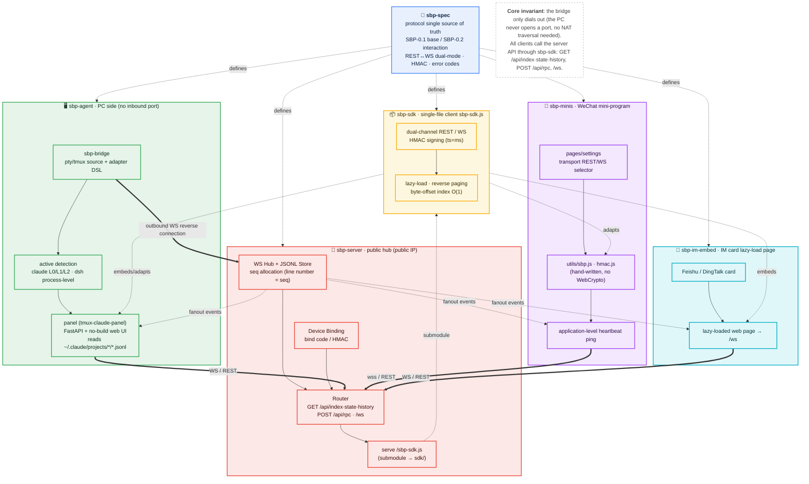
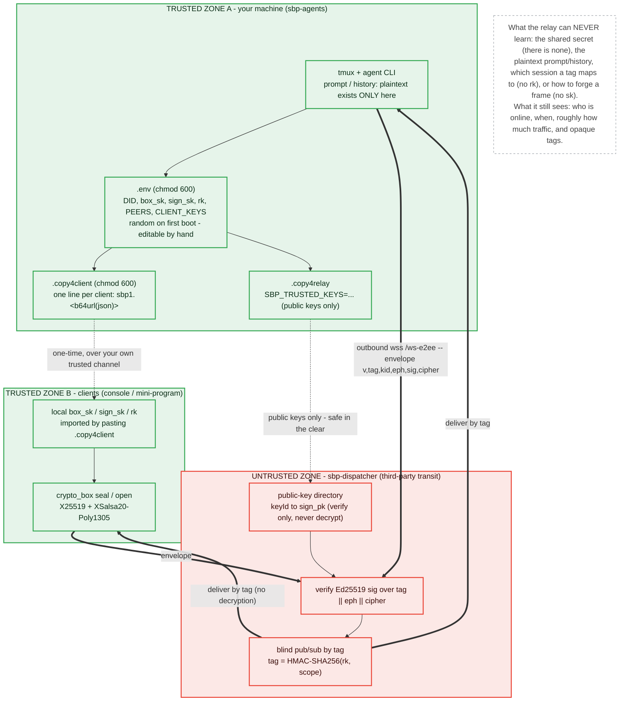

# SBP · Session Bridge Protocol — Specification Repository

> Let an "IM web page / mini-program" take over the Agent session running on your computer
> (claude-code / codex / dsh / hermes / openclaw / workbuddy / qwen-office).
> Spec first, then implementation. This repository holds **only the protocol specification** — no runtime code.

## Repository Split

SBP is split into 6 independent repositories. This one is the "contract" that every other repository depends on:

| Repo | Role | Notes |
|---|---|---|
| [sbp-spec](https://github.com/sbp4ai/sbp-spec) | Protocol spec (this repo) | roles / frames / message tables / lazy-loading / security / evolution + agent adapter mapping |
| [sbp-server](https://github.com/sbp4ai/sbp-server) | Public relay | auth, device-code binding, routing, JSONL persistence, reverse paging, seq allocation; pulls in sbp-sdk via submodule |
| [sbp-sdk](https://github.com/sbp4ai/sbp-sdk) | Web client library | single-file `sbp-sdk.js`, served by sbp-server as a static file for the IM card |
| [sbp-agent](https://github.com/sbp4ai/sbp-agent) | Local daemon | runs on the machine running tmux+claude: panel (tmux-claude panel) + bridge (PC-side bridge) + demo · panel on PyPI: [`tmux-ai-coder-panel`](https://pypi.org/project/tmux-ai-coder-panel/) |
| [sbp-minis](https://github.com/sbp4ai/sbp-minis) | WeChat mini-program | drive sessions from a phone (REST polling default, WS optional; E2EE via tweetnacl) |
| [sbp-console](https://github.com/sbp4ai/sbp-console) | Web console | one page for N servers, no build step; E2EE via libsodium |
| [sbp-im-embed](https://github.com/sbp4ai/sbp-im-embed) | IM-embed skill | a Skill that lets an agent lazy-load an SBP web page inside an IM |

The three runtime pieces are also published as PyPI packages (repos under `sbp4ai/`):

| Package | Repo | Role |
|---|---|---|
| [`sbp4ai-client`](https://pypi.org/project/sbp4ai-client/) | sbp-client | E2EE crypto core (PyNaCl) + `E2EELink`; shared by both ends |
| [`sbp-dispatcher`](https://pypi.org/project/sbp-dispatcher/) | sbp-dispatcher | the relay — public-key directory + opaque-tag routing, holds **no** secret |
| [`sbp-agents`](https://pypi.org/project/sbp-agents/) | sbp-agents | on-device daemon (tmux panel + bridge); generates and owns all private keys |

> Splitting principle: spec is the single contract (versioned); server and agent are the two runtime ends;
> sdk is the shared web library (depended on by server, hence submodule instead of copy);
> minis and im-embed are two different shapes of consumer.

## Architecture & Inter-repo Call Graph



> Edge legend: **dashed "defines"** = sbp-spec is the protocol authority; **dashed "submodule"** = sbp-server mounts sbp-sdk as a submodule;
> **dashed "embeds/adapts"** = clients embed sbp-sdk; **solid bold "calls"** = runtime calls (bridge only dials out; others talk to server via WS/REST).
> The full editable source is in [`architecture.mmd`](./architecture.mmd).

## Protocol Versions

The spec evolves as a **versioned contract**; implementations should pin to a version:

- Current baseline: **SBP/0.2** (`SBP-0.1.md` roles/frames/lazy-loading + `SBP-0.2-interaction.md` option cards + `SBP-transport.md` transport choice)
- Each implementation advertises its protocol version at handshake (e.g. `sbp-server`'s `VERSION = "sbp/0.1"`,
  `sbp-sdk`'s `V = "sbp/0.1"`, `sbp-agent` panel's `version="0.1.0"`); on cross-repo drift, degrade or error accordingly
- This repo carries a lightweight tag `sbp/0.2` marking the current baseline; `git checkout sbp/0.2` locks the contract

> Implementations currently still lean toward `sbp/0.1` (handshake sub-protocol `sbp.v0.1`); before moving to 0.2, align on the
> `session.prompt/answer` frames in `SBP-0.2-interaction.md` first.

## SBP-0.4 — End-to-End Encryption over an Untrusted Relay

The relay (`sbp-dispatcher`) may be a third-party box. SBP-0.4 turns it into a **post office that cannot read the
letters**: it holds only signing *public* keys, routes by an opaque tag, and verifies a signature on every frame.

### Key custody & trust boundary



### Boot → import → connect

```mermaid
sequenceDiagram
    autonumber
    participant A as sbp-agents (device)
    participant FS as .env / .copy4client
    participant R as sbp-dispatcher (untrusted)
    participant U as client (console / minis)

    A->>FS: first boot: random DID, box_sk, sign_sk, rk, 2 client keys
    A->>FS: write .copy4client (sbp1. lines) + .copy4relay (public keys)
    A->>A: print the same block to the terminal
    FS-->>U: you paste .copy4client into the import box (one-shot)
    A->>R: outbound wss /ws-e2ee; hello {keyId, ts, nonce, sig}
    R->>R: sign_pk from SBP_TRUSTED_KEYS -> verify challenge (5 min window)
    R-->>A: hello.ok
    U->>R: hello (same, signed with the imported key)
    R-->>U: hello.ok
    U->>R: ctl sub {tag, kid, sig}   %% tag = HMAC(rk, "dev|<did>")
    A->>R: envelope {tag, kid, eph, sig, cipher}
    R->>R: verify sig; deliver to subscribers of tag (never decrypts)
    R-->>U: envelope
    U->>U: crypto_box_open with local box_sk -> inner SBP frame
```

### Degradation path

| Situation | Behaviour |
|---|---|
| Both ends have pinned keys | E2EE on `/ws-e2ee` (default for imported configs) |
| Trusted LAN, no E2EE config | legacy `/ws` + HMAC — plaintext to the relay, still authenticated |
| Peer public key missing | **refuse**, never silently downgrade |

Full spec: [`spec/SBP-0.4-e2ee.md`](./spec/SBP-0.4-e2ee.md).

## Why CS, not P2P

The controlled computer **only ever dials out** to the server. No open ports, no NAT traversal, no same-LAN requirement.

## Directory

```
spec/
  SBP-0.1.md              protocol body (roles / frames / message tables / lazy-loading / security / evolution)
  SBP-0.2-interaction.md  interaction prompts: session.prompt / session.answer, option cards, 3-level degradation
  SBP-0.4-e2ee.md         end-to-end encryption: handshake, envelope, key derivation, degradation
  SBP-transport.md        transport choice: WebSocket push vs HTTP polling+ETag vs MQTT
  schema/*.json           JSON Schema for envelope and session index
  adapters/*.yaml         formal mapping for 8 agents (declarative only, no scripts)
```

## Default Transport

**REST polling + ETag is the primary transport**; WebSocket is an optional upgrade (see `SBP-transport.md`).
Rationale: under the trade-off "save server resources > real-time, and no WS long connection", a polling connection costs
almost nothing after it closes, and an unchanged poll is just a 304 comparison; WS must hold a socket and push on every change.

---

# SBP · Session Bridge Protocol — 规范仓库（中文）

> 让「IM 里的一个网页 / 小程序」接管「你电脑上正在跑的 Agent 会话」
> （claude-code / codex / dsh / hermes / openclaw / workbuddy / qwen-office）。
> 先定协议，再落地实现。本仓库只放**协议规范本身**，不含任何运行时代码。

## 仓库划分

SBP 拆成 6 个独立仓库，本仓库是「协议契约」，其余都依赖它：

| 仓库 | 角色 | 说明 |
|---|---|---|
| [sbp-spec](https://github.com/sbp4ai/sbp-spec) | 协议规范（本仓库） | 角色/帧/消息表/懒加载/安全/演进 + agent adapter 映射 |
| [sbp-server](https://github.com/sbp4ai/sbp-server) | 公网中继 | 鉴权、设备码绑定、路由、JSONL 持久化、倒序分页、seq 分配；以 submodule 引入 sbp-sdk |
| [sbp-sdk](https://github.com/sbp4ai/sbp-sdk) | 网页客户端库 | 单文件 `sbp-sdk.js`，被 sbp-server 作为静态文件提供给 IM 卡片 |
| [sbp-agent](https://github.com/sbp4ai/sbp-agent) | 本机守护 | 装在跑 tmux+claude 的机器上：panel(tmux-claude 面板)+bridge(PC 侧桥接)+demo · 面板已发布 PyPI：[`tmux-ai-coder-panel`](https://pypi.org/project/tmux-ai-coder-panel/) |
| [sbp-minis](https://github.com/sbp4ai/sbp-minis) | 微信小程序 | 手机端驱动会话（REST 轮询默认，WS 可选；E2EE 走 tweetnacl） |
| [sbp-console](https://github.com/sbp4ai/sbp-console) | 网页控制台 | 一个页面看 N 台服务器，无构建步骤；E2EE 走 libsodium |
| [sbp-im-embed](https://github.com/sbp4ai/sbp-im-embed) | IM 内嵌技能 | 让智能体在 IM 里懒加载 SBP 网页的 Skill |

三个运行时部件另外以 PyPI 包发布（仓库同在 `sbp4ai/`）：

| 包 | 仓库 | 角色 |
|---|---|---|
| [`sbp4ai-client`](https://pypi.org/project/sbp4ai-client/) | sbp-client | E2EE 加密内核（PyNaCl）+ `E2EELink`，两端共用 |
| [`sbp-dispatcher`](https://pypi.org/project/sbp-dispatcher/) | sbp-dispatcher | 中继：公钥目录 + 按 tag 盲路由，**不持有任何密钥** |
| [`sbp-agents`](https://pypi.org/project/sbp-agents/) | sbp-agents | 设备端守护（tmux 面板 + 桥接），生成并独占全部私钥 |

> 划分原则：spec 是唯一契约（版本化）；server 与 agent 是两端的运行时；sdk 是共享网页库
> （被 server 依赖，故以 submodule 引入而非复制）；minis 与 im-embed 是两种不同形态的消费端。

## 架构与仓库调用关系

（架构图见上方英文区的 mermaid，或独立的 [`architecture.mmd`](./architecture.mmd)。）

边样式速读：**虚线「定义」** = sbp-spec 是协议权威；**虚线「submodule」** = sbp-server 以 submodule 挂载 sbp-sdk；
**虚线「嵌入/适配」** = 客户端内嵌 sbp-sdk；**实线粗箭头「调用」** = 运行时调用（bridge 仅出站反向连接，其余经 WS/REST 调 server）。

## 协议版本

规范按**版本化契约**演进，实现方应固定到某个版本：

- 当前基线：**SBP/0.2**（`SBP-0.1.md` 角色/帧/懒加载 + `SBP-0.2-interaction.md` 选项卡片 + `SBP-transport.md` 传输选型）
- 每个实现在握手时通告自己的协议版本（如 `sbp-server` 的 `VERSION = "sbp/0.1"`、
  `sbp-sdk` 的 `V = "sbp/0.1"`、`sbp-agent` panel 的 `version="0.1.0"`），跨仓漂移时据此降级或报错
- 本仓库打有轻量 tag `sbp/0.2` 标记当前基线；实现方 `git checkout sbp/0.2` 即可锁定契约

> 各实现目前仍偏 `sbp/0.1`（握手子协议 `sbp.v0.1`），升级到 0.2 前请先对齐 `SBP-0.2-interaction.md` 的 `session.prompt/answer` 帧。

## SBP-0.4 — 不可信中继上的端到端加密

中继（`sbp-dispatcher`）可能是第三方的机器。SBP-0.4 把它变成「**读不到信内容的邮局**」：
只持有签名公钥、只按不透明 tag 路由、对每帧验签。

### 密钥托管与信任边界

（图见上方英文区的 mermaid，两区说明如下。）

- **可信区 A（你的机器 / sbp-agents）**：私钥在这里随机生成，只落在 `.env`（600）里，永远不出端。
  prompt、会话历史的明文只存在于这一侧。
- **不可信区（sbp-dispatcher）**：只有 `SBP_TRUSTED_KEYS=keyId:sign_pk[:box_pk]`；没有 rk，所以算不出
  tag 对应哪个会话；没有 sk，所以伪造不了帧；没有 box_sk，所以解不开密文。
- **可信区 B（控制台 / 小程序）**：粘贴 `.copy4client` 一次性导入私钥，之后本地保存。

### 启动 → 导入 → 连上

1. 首次启动：随机生成 DID、`box_sk`/`sign_sk`、`rk`（64-hex）、两台客户端密钥，写进 `.env`。
2. 生成 `.copy4client`（每台客户端一行 `sbp1.<base64url(json)>`）与 `.copy4relay`（只有公钥），
   同时在终端另起一段打印出来。
3. 你在客户端「粘贴导入」框里整段粘贴 —— 一次导入两台客户端（网页控制台 + 微信小程序）。
4. 客户端连 `/ws-e2ee`：先发明文 `hello`（带 Ed25519 签名挑战），中继用登记的公钥验签；
   之后每一帧都是信封 `{v,tag,kid,eph,sig,cipher}`，中继只验签 + 按 tag 投递。

### 降级路径

| 情况 | 行为 |
|---|---|
| 两端都有登记好的公钥 | 走 `/ws-e2ee`，端到端加密（导入的配置默认就是这条） |
| 可信局域网、没配 E2EE | 走老的 `/ws` + HMAC —— 中继能看到明文，但仍有鉴权 |
| 缺对端公钥 | **直接拒绝**，绝不静默降级成明文 |

完整规范：[`spec/SBP-0.4-e2ee.md`](./spec/SBP-0.4-e2ee.md)。

## 为什么是 CS 而不是 P2P

被控电脑永远只**出站**连 server。不开端口、不配内网穿透、不依赖同一局域网。

## 目录

```
spec/
  SBP-0.1.md              协议正文（角色/帧/消息表/懒加载/安全/演进）
  SBP-0.2-interaction.md  交互提示：session.prompt / session.answer、选项卡片、三级降级
  SBP-0.4-e2ee.md         端到端加密：握手、信封格式、密钥派生、降级路径
  SBP-transport.md        传输选型：WebSocket 推送 vs HTTP 轮询+ETag vs MQTT
  schema/*.json           envelope 与 session 索引的 JSON Schema
  adapters/*.yaml         8 个 agent 的形式化映射（纯声明式，禁止脚本）
```

## 传输默认

**REST 轮询 + ETag 作为主传输**，WebSocket 降级为可选升级（详见 `SBP-transport.md`）。
理由：在「省服务器资源 > 实时性、且不要 WS 长连接」的取舍下，轮询关闭连接后服务端几乎零成本，
未变化的轮询只是一次 304 比对；WS 则要始终持有 socket 并在每次变化时被推。
