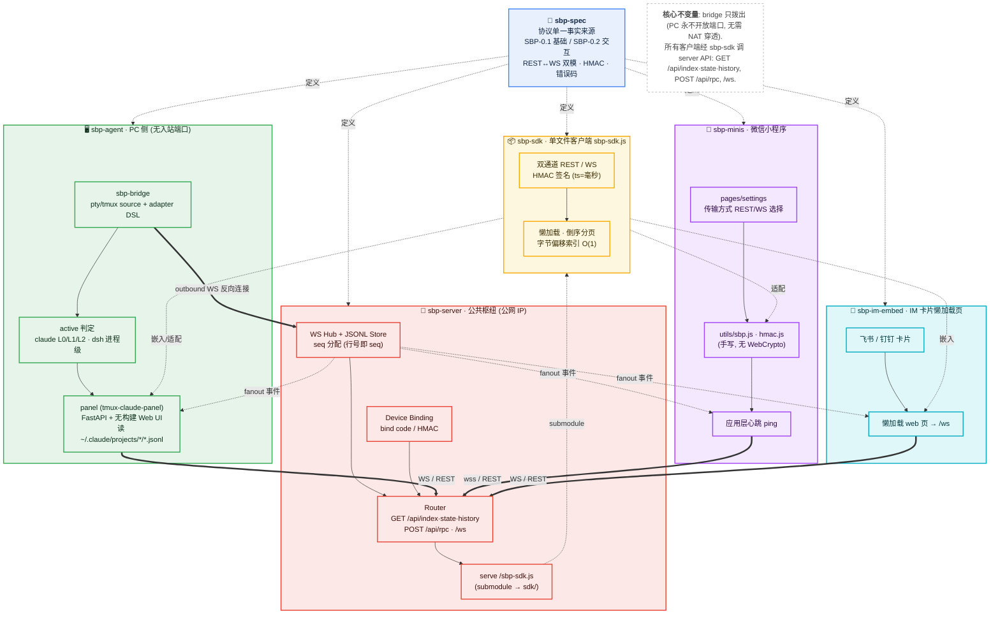

# SBP · Session Bridge Protocol — 规范仓库

> 让「IM 里的一个网页 / 小程序」接管「你电脑上正在跑的 Agent 会话」
> （claude-code / codex / dsh / hermes / openclaw / workbuddy / qwen-office）。
> 先定协议，再落地实现。本仓库只放**协议规范本身**，不含任何运行时代码。

## 仓库划分

SBP 拆成 6 个独立仓库，本仓库是「协议契约」，其余都依赖它：

| 仓库 | 角色 | 说明 |
|---|---|---|
| [sbp-spec](https://github.com/sbp4ai/sbp-spec) | 协议规范（本仓库） | 角色/帧/消息表/懒加载/安全/演进 + agent adapter 映射 |
| [sbp-server](https://github.com/sbp4ai/sbp-server) | 公网中继 | 鉴权、设备码绑定、路由、JSONL 持久化、倒序分页、seq 分配；以 submodule 引入 sbp-sdk |
| [sbp-sdk](https://github.com/sbp4ai/sbp-sdk) | 网页客户端库 | 单文件 `sbp-sdk.js`，被 sbp-server 作为静态文件提供给 IM 卡片 |
| [sbp-agent](https://github.com/sbp4ai/sbp-agent) | 本机守护 | 装在跑 tmux+claude 的机器上：panel(tmux-claude 面板)+bridge(PC 侧桥接)+demo |
| [sbp-minis](https://github.com/sbp4ai/sbp-minis) | 微信小程序 | 手机端驱动会话（REST 轮询默认，WS 可选） |
| [sbp-im-embed](https://github.com/sbp4ai/sbp-im-embed) | IM 内嵌技能 | 让智能体在 IM 里懒加载 SBP 网页的 Skill |

> 划分原则：spec 是唯一契约（版本化）；server 与 agent 是两端的运行时；sdk 是共享网页库
> （被 server 依赖，故以 submodule 引入而非复制）；minis 与 im-embed 是两种不同形态的消费端。

## 架构与仓库调用关系



> 边样式速读：**虚线「定义」** = sbp-spec 是协议权威；**虚线「submodule」** = sbp-server 以 submodule 挂载 sbp-sdk；
> **虚线「嵌入/适配」** = 客户端内嵌 sbp-sdk；**实线粗箭头「调用」** = 运行时调用（bridge 仅出站反向连接，其余经 WS/REST 调 server）。
> 完整可编辑源见 [`architecture.mmd`](./architecture.mmd)。

## 协议版本

规范按**版本化契约**演进，实现方应固定到某个版本：

- 当前基线：**SBP/0.2**（`SBP-0.1.md` 角色/帧/懒加载 + `SBP-0.2-interaction.md` 选项卡片 + `SBP-transport.md` 传输选型）
- 每个实现在握手时通告自己的协议版本（如 `sbp-server` 的 `VERSION = "sbp/0.1"`、
  `sbp-sdk` 的 `V = "sbp/0.1"`、`sbp-agent` panel 的 `version="0.1.0"`），跨仓漂移时据此降级或报错
- 本仓库打有轻量 tag `sbp/0.2` 标记当前基线；实现方 `git checkout sbp/0.2` 即可锁定契约

> 各实现目前仍偏 `sbp/0.1`（握手子协议 `sbp.v0.1`），升级到 0.2 前请先对齐 `SBP-0.2-interaction.md` 的 `session.prompt/answer` 帧。

## 为什么是 CS 而不是 P2P

被控电脑永远只**出站**连 server。不开端口、不配内网穿透、不依赖同一局域网。

## 目录

```
spec/
  SBP-0.1.md              协议正文（角色/帧/消息表/懒加载/安全/演进）
  SBP-0.2-interaction.md  交互提示：session.prompt / session.answer、选项卡片、三级降级
  SBP-transport.md        传输选型：WebSocket 推送 vs HTTP 轮询+ETag vs MQTT
  schema/*.json           envelope 与 session 索引的 JSON Schema
  adapters/*.yaml         8 个 agent 的形式化映射（纯声明式，禁止脚本）
```

## 传输默认

**REST 轮询 + ETag 作为主传输**，WebSocket 降级为可选升级（详见 `SBP-transport.md`）。
理由：在「省服务器资源 > 实时性、且不要 WS 长连接」的取舍下，轮询关闭连接后服务端几乎零成本，
未变化的轮询只是一次 304 比对；WS 则要始终持有 socket 并在每次变化时被推。
