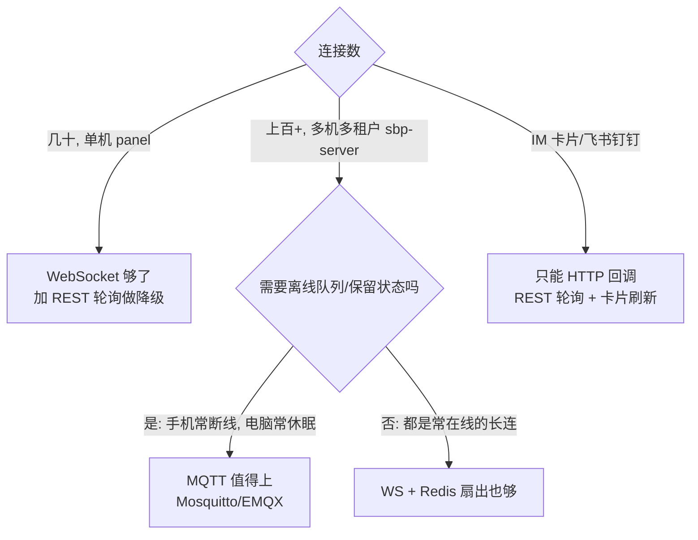

# SBP 传输层选型：WebSocket 一定比 HTTP 轮询省吗？

> 结论先放：**不一定。** 在我们这个场景里，「省不省服务器资源」几乎不由协议决定，
> 而由**贵的活儿是不是被共享、是不是按需触发**决定。协议只决定延迟和字节数。

## 1. 先看清成本在哪

在 `panel/` 上实测的单次操作成本（环境无关指标：fork 子进程次数、open 文件次数）：

| 操作 | fork | open | 说明 |
| --- | ---: | ---: | --- |
| `pane.snapshot` 抓一屏 | **4** | 0 | `tmux capture-pane` 走 4 次 `_run` |
| `sessions.index` 建索引 | **62** | **84** | 5 个 tmux 会话 × pane 枚举 + 57 个 jsonl 的 `entry()` |
| `claude.since` 增量读 | 0 | 1 | 有 LineIndex 字节偏移，几乎免费 |

**建一次索引 ≈ 抓 15 次屏。** 所以：

- 谁决定要不要重建索引，谁就决定了成本；
- N 个客户端各自触发一次重建，成本就是 N × 62 fork —— 这才是轮询"浪费"的真正来源，
  不是 HTTP 头那几百字节。

## 2. 实测：三种传输

`panel/tests/transport_bench.py`，同一台机器、同一个静止终端、每次 15s：

| 传输 | 1 客户端<br>子进程CPU s/min | 3 客户端<br>子进程CPU s/min | 1 客户端<br>收 B/min | 3 客户端<br>收 B/min |
| --- | ---: | ---: | ---: | ---: |
| WS 推送（tick 1.2s） | 4.03 | 3.39 | 57 K | **8.9 K** |
| HTTP 轮询 5s | 3.35 | 3.07 | 169 K | 501 K |
| HTTP 轮询 5s + ETag | **3.04** | **2.82** | 57 K | 179 K |
| HTTP 轮询 1s | 5.56 | 6.18 | 772 K | 2 287 K |
| HTTP 轮询 1s + ETag | 4.96 | 5.36 | 63 K | 193 K |

读法：

1. **5 秒轮询比 WS 更省 CPU**（3.35 vs 4.03）。原因不是协议，是 WS 的 tick 固定 1.2s，
   而轮询模式下服务端把 tick 放宽到「轮询间隔的一半」= 2.5s，抓屏次数减半。
2. **想追平 WS 的延迟（1s 轮询），CPU 反而更贵**（5.56 vs 4.03）。
   **延迟要用 CPU 买，协议省不了。**
3. **轮询成本不随人数增长**（1 人 3.35 → 3 人 3.07，基本持平）。
   前提是抓屏/索引有共享缓存；没有缓存时，3 人 × 5s 轮询 ≈ 36 次 × 66 fork
   = 2376 fork/min，是实测值 192 的 **12 倍**。
4. **ETag 是带宽上最大的杠杆**：1s × 3 人从 2.29 MB/min 降到 193 KB/min（**11.8×**）。
   静止时 WS 最省（只有变化才发），加了 ETag 的轮询差一个数量级以内。

> 一句话：**轮询省的是「服务端可以睡更久」，WS 省的是「没变化就一个字节都不发」。
> 你要哪个，取决于终端是常常在动，还是常常不动。**

## 3. 各协议的每消息开销

| 协议 | 每消息额外开销 | 连接保活 | 断线重连 | 服务端推送 | 浏览器 | 微信小程序 |
| --- | --- | --- | --- | --- | --- | --- |
| WebSocket | 2–6 B 帧头（客户端→服务端 +4 B 掩码） | 需自己 ping/pong | 自己写退避 | 原生 | 原生 | 可用，**进后台 5s 即断** |
| SSE | `data:` + `\n\n` ≈ 8 B | 心跳注释 | **EventSource 自动重连 + Last-Event-ID** | 原生（单向） | 原生 | ❌ 无流式响应 |
| HTTP 长轮询 | 请求+响应头 ≈ 400–600 B | 请求本身就是保活 | 重试即可 | 变相支持 | 原生 | ✅ |
| HTTP 轮询 | 同上；304 时无 body | 无 | 无 | ❌ | 原生 | ✅ |
| MQTT | 2–4 B 固定头 + 主题长度 + 主题名 | PINGREQ 2 B | **会话保持 + 离线队列** | 原生（via broker） | 需 MQTT-over-WS | 需 mqtt.js over wss |
| gRPC / HTTP2 | HPACK 压缩后 ≈ 10–30 B + 5 B 帧头 | HTTP2 PING | 需自己写 | 流式 | 需 gRPC-Web | ❌ |

注意：**这些头部差异在本项目里是噪声**。我们的负载是几 KB 的屏幕和 15 KB 的索引，
每消息省 4 字节 vs 8 字节毫无意义。**真正决定成本的是消息条数，不是每条几个字节。**

## 4. MQTT 值不值得上

MQTT 相对 WS 的真实增量（不是"头部小 4 字节"这种）：

| 能力 | WS 要自己实现 | MQTT 白送 | 对本项目的价值 |
| --- | --- | --- | --- |
| 保留消息（Retained） | 自己做 last-value 缓存 | ✅ | **高**：手机重连立刻拿到最新索引，不必唤醒可能已休眠的电脑 |
| 遗嘱消息（LWT） | 自己做心跳超时判定 | ✅ | **高**：bridge 掉线立刻广播"离线"，不用等超时 |
| 离线队列（QoS1 + 持久会话） | 自己做 seq 重放 | ✅ | **中**：我们已有 `seq`/`ref`，但只在连接存活时有效 |
| Broker 侧扇出 | 自己 `await send()` N 次 | ✅ | **中**：C 实现的 broker 扇出比 Python 便宜，但连接数是几十不是几十万 |
| 主题级路由 | 自己做订阅表 | ✅ | 低：我们的订阅就是 `sid` 一维 |

代价：

- **多一个进程**：Mosquitto 单进程 epoll，空闲连接 2–10 KB/连接，单核上限；
  几十个连接完全不是瓶颈，但部署、鉴权、ACL、TLS 都要多配一遍。
- **没有原生请求/响应**（MQTT 3.1.1）：`session.answer` 这类要等 bridge 回包的调用，
  得自己做关联 ID —— SBP 的 `id`/`ref` 已经覆盖了，所以其实不痛；
  MQTT 5 的 response-topic 更省事。
- **浏览器不支持原生 MQTT**：要跑 MQTT-over-WebSocket，帧头开销又回来了。

**判断**：



## 5. SSE：被低估的中间选项

如果要"推送 + 不引入 broker + 纯 HTTP"，**SSE 是性价比最高的**：

- 单向推送，写操作走 `POST /api/rpc` —— 正好是本项目已经拆好的形状；
- `EventSource` 自带重连和 `Last-Event-ID` 断点续传，比手写 WS 重连少一堆 bug；
- 就是普通 HTTP，nginx/CDN/企业代理不会像对待 WS 那样缓冲或掐断；
- **缺点**：小程序没有 SSE（`wx.request` 不支持流式），所以小程序侧仍要轮询。

## 6. 本项目的落地

SBP 帧语义与传输解耦：换传输只换 envelope，`_dispatch` 只有一份。

| 端 | 选择 | 理由 |
| --- | --- | --- |
| `panel/` 网页 | **REST 轮询默认（`?transport=rest&interval=N`），`?transport=ws` 才开长连接；WS 连不上自动降级回轮询** | 省服务端、无长连接；只有明确要最低延迟时才开 WS |
| 微信小程序 | **REST 轮询为主** | WS 进后台 5 秒就断，前台再补 WS 得不偿失；轮询 + ETag 已足够省 |
| `sbp-server` 接 bridge | WS（现状）；规模上来再评估 MQTT | bridge 是常在线长连，保留消息/LWT 的收益要等规模才体现 |
| IM 卡片 | REST | 卡片回调本来就是 HTTP POST |

### 已实现的省资源机制（与协议无关，三个一起上才有效）

1. **共享抓屏缓存** `hub.screen(key, ttl=1s)`：并发/高频轮询共用一次 `capture-pane`。
2. **服务端只重建一次索引**：`INDEX_TTL` 与 `PUSH_TTL` 对齐到 6s，tick 负责重建，
   HTTP 轮询者直接读缓存 —— 人数不放大成本。
3. **自适应 tick**：`_period()` 取所有观察者里最急的那个；只有 5s 轮询者时按 2.5s 抓屏，
   比固定 1.2s 省一半 fork；没人看时空转 3s。
4. **ETag / If-None-Match**：`/api/index`、`/api/state` 都带指纹，没变回 304 不带 body。
   （坑：索引里别塞每次都变的 `ts`，否则指纹永远对不上，304 一次都命中不了。）
5. **扇出只序列化一次** `hub._fanout()`：N 个连接以前是 N 次 `json.dumps`。

## 7. 复现

```bash
cd panel && python tests/transport_bench.py --dur 15 --clients 1,3 --interval 5,1
```

输出子进程 CPU、fork 次数、抓屏次数、客户端收到字节数，写到 `docs/transport_bench.json`。
线上诊断同源数据看 `GET /api/stats`（`tmux_runs` / `captures` / `ticks` / `period`）。
